# 多角度参考与身高

每位角色都有1张白底全身4视图，共11张参考板、44个角度视图。全部使用内置image_gen从原始角色图生成，实际提示词保存在图片旁的`turnaround-v1.prompt.txt`。

每张图从左到右依次为正面、朝画面左的侧面、朝画面右的侧面、背面。四个身体是同一个角色的四个角度，不是四人合照。

## 多人图身高

| 参考身高 | 角色 |
| --- | --- |
| 185cm | 戴而 |
| 180cm | 魏子奇、夏炜城 |
| 175cm | 李彦臻、罗宇伦、彭鹏、唐博釜、唐胤鑫、詹绍源 |
| 160cm | 涂腾辉、黎健毓 |

这些是用户指定的场景构图基准。相近镜头距离、同一地面上按185:180:175:160安排；鹿角等突出附属物不计入身高。保持胖瘦和肢体比例，远近、坐姿、台阶等造成的视觉高度变化按实际场景处理。

## 使用方式

以新参考板选择全身姿态和侧背面角度，原图用于脸部及配件细节。各板单独构图，不能用画面中的像素高度比较不同人物。相机、平板、香烟和背包等可移动道具在标准板中减少或移除，可按生活场景再加入。

未在原图出现的侧面、背面和下半身是生成补全。涂腾辉原图只有半身，新板延续西装补出西裤、皮鞋和手部。罗宇伦的手表在侧面图中未稳定呈现，配件设定仍以原图和当次要求为准。

## 角色参考板

### 李彦臻·175cm

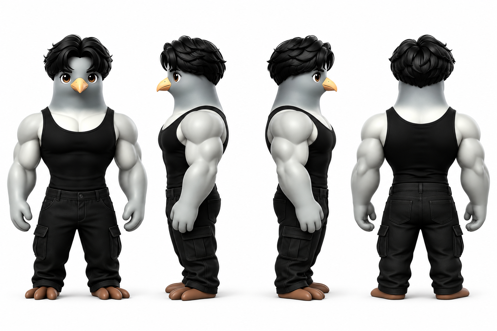

[原始参考](../assets/characters/li-yanzhen/李彦臻.jpg) · [本次生成提示词](../assets/characters/li-yanzhen/turnaround-v1.prompt.txt)

### 罗宇伦·175cm

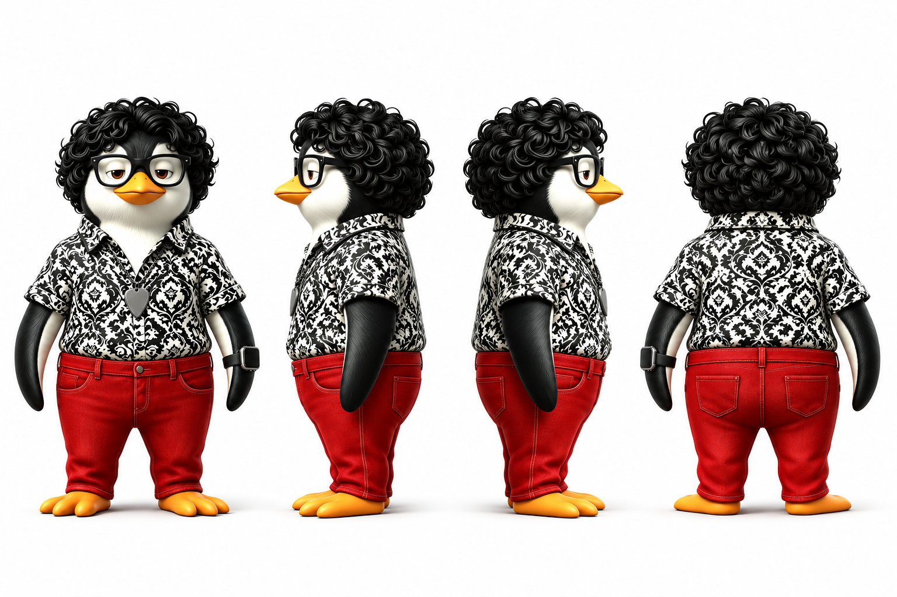

[原始参考](../assets/characters/luo-yulun/罗宇伦.jpg) · [本次生成提示词](../assets/characters/luo-yulun/turnaround-v1.prompt.txt)

### 彭鹏·175cm

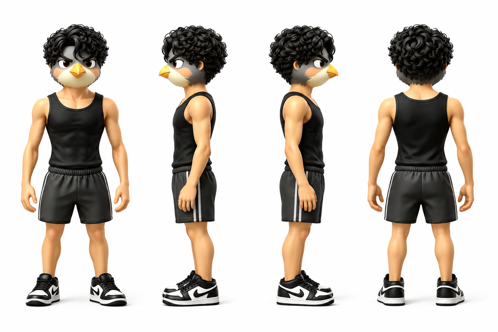

[原始参考](../assets/characters/peng-peng/彭鹏.jpg) · [本次生成提示词](../assets/characters/peng-peng/turnaround-v1.prompt.txt)

### 唐博釜·175cm

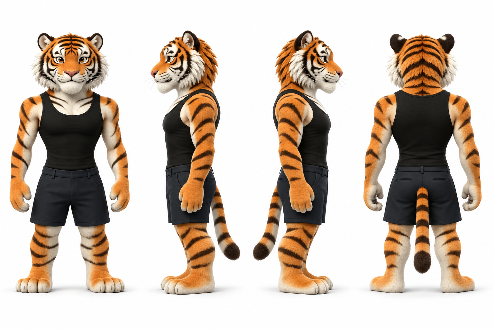

[原始参考](../assets/characters/tang-bofu/唐博釜.jpg) · [本次生成提示词](../assets/characters/tang-bofu/turnaround-v1.prompt.txt)

### 唐胤鑫·175cm

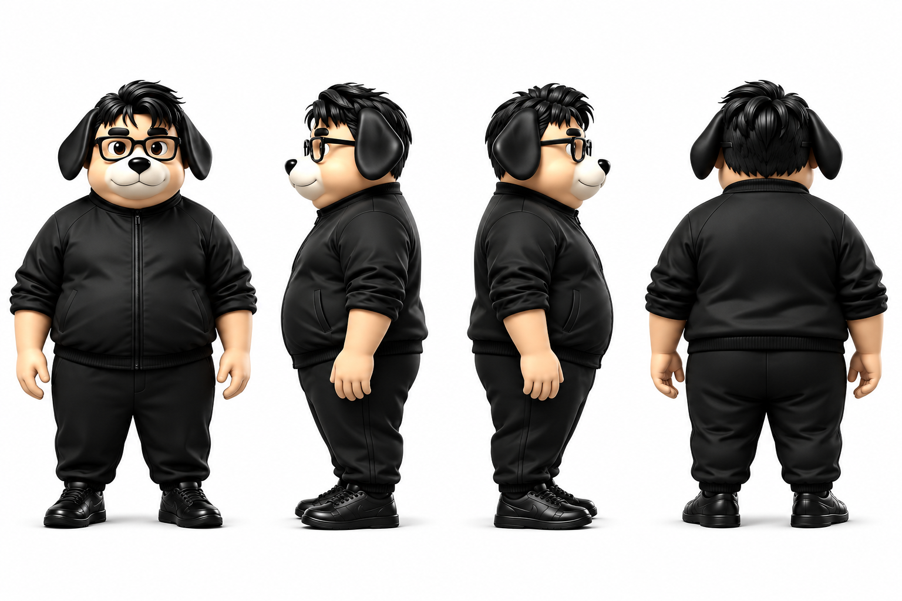

[原始参考](../assets/characters/tang-yinxin/唐胤鑫.jpg) · [本次生成提示词](../assets/characters/tang-yinxin/turnaround-v1.prompt.txt)

### 涂腾辉·160cm

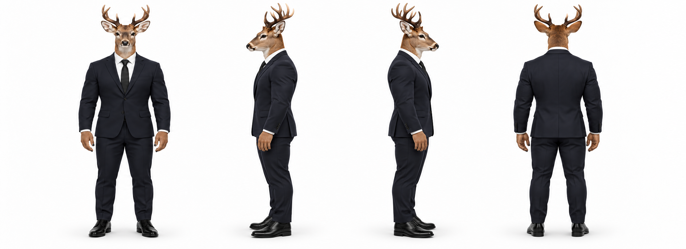

[原始参考](../assets/characters/tu-tenghui/涂腾辉.jpg) · [本次生成提示词](../assets/characters/tu-tenghui/turnaround-v2.prompt.txt)

### 魏子奇·180cm

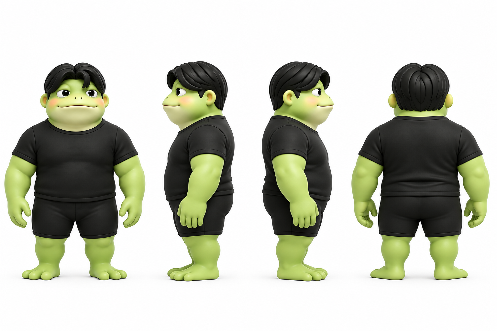

[原始参考](../assets/characters/wei-ziqi/魏子奇.jpg) · [本次生成提示词](../assets/characters/wei-ziqi/turnaround-v1.prompt.txt)

### 夏炜城·180cm

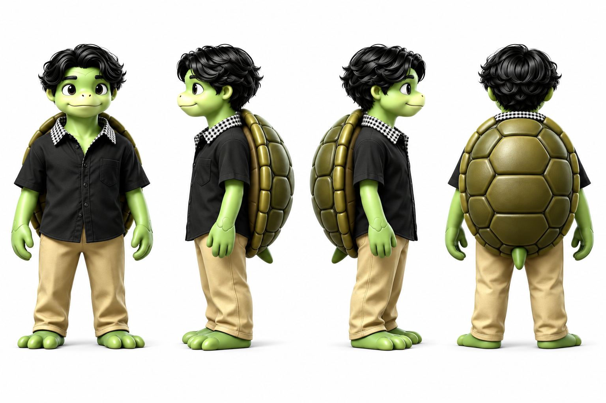

[原始参考](../assets/characters/xia-weicheng/夏炜城.jpg) · [本次生成提示词](../assets/characters/xia-weicheng/turnaround-v1.prompt.txt)

### 詹绍源·175cm

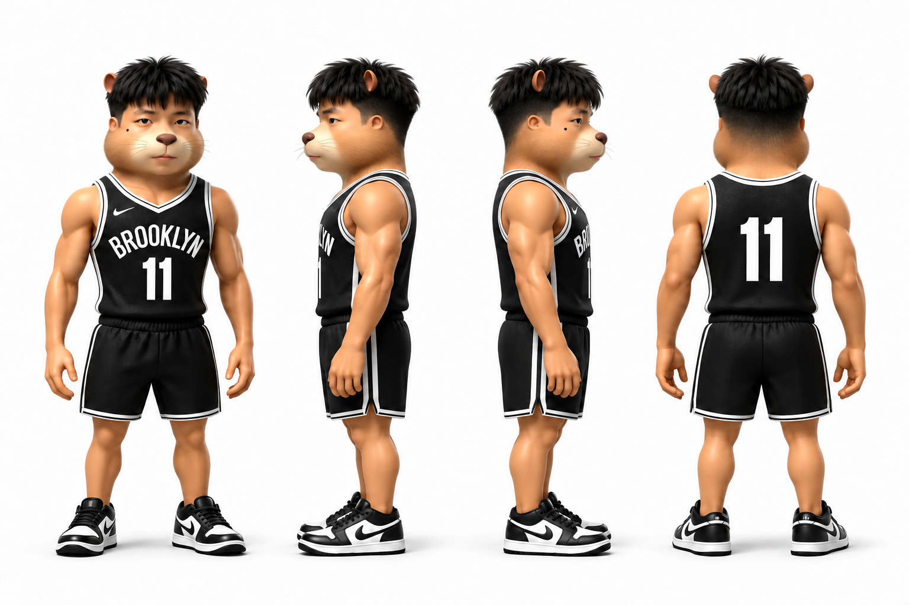

[原始参考](../assets/characters/zhan-shaoyuan/詹绍源.jpg) · [本次生成提示词](../assets/characters/zhan-shaoyuan/turnaround-v1.prompt.txt) · [局部修正提示词](../assets/characters/zhan-shaoyuan/turnaround-v1.repair.prompt.txt)

### 黎健毓·160cm

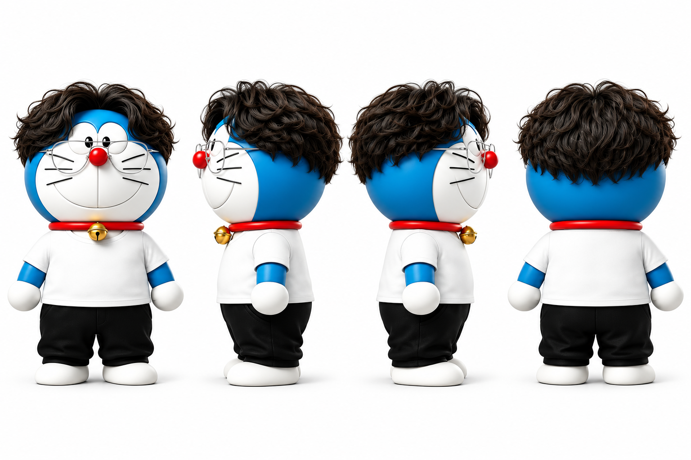

[原始参考](../assets/characters/li-jianyu/黎健毓.jpg) · [本次生成提示词](../assets/characters/li-jianyu/turnaround-v1.prompt.txt)

### 戴而·185cm

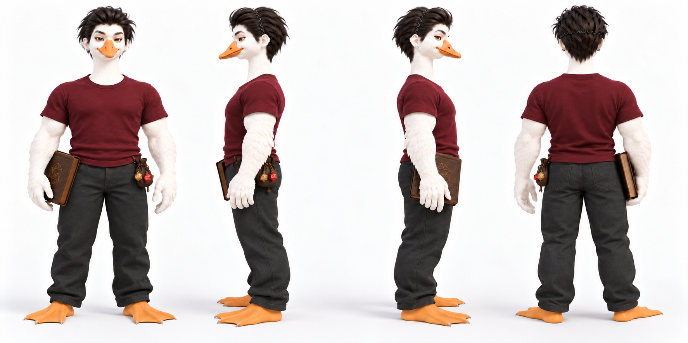

[原始定稿](../assets/characters/dai-er/戴而.png) · [生成提示词](../assets/characters/dai-er/turnaround-v1.prompt.txt) · [视角修正提示词](../assets/characters/dai-er/turnaround-v1.repair.prompt.txt)

保留酒红色短袖、深灰长裤、波浪发箍、小圆耳钉和裸露橙色鹅蹼。体型为微胖结实的男性，有适量胸肌与臂肌。按用户要求，四视图保留右手书册、左腰皮袋和骰子挂饰，不因标准化移除；远侧道具可被身体自然遮挡。侧背面为生成补全，细节冲突时优先遵从原始定稿。
## 单人白底标准图

每位角色另有identity-square-v1.png，统一为1:1白底无水印单人图；使用preferred_identity_reference读取。原始图保留，标准图不覆盖原始身份来源。单图各自充分展示，多人图按185:180:175:160安排，不按不同文件的像素高度比较人物。

涂腾辉已按用户要求补成全身，并参考彭鹏的结实程度调整体型；最新四视图为turnaround-v2.png，旧版保留。
